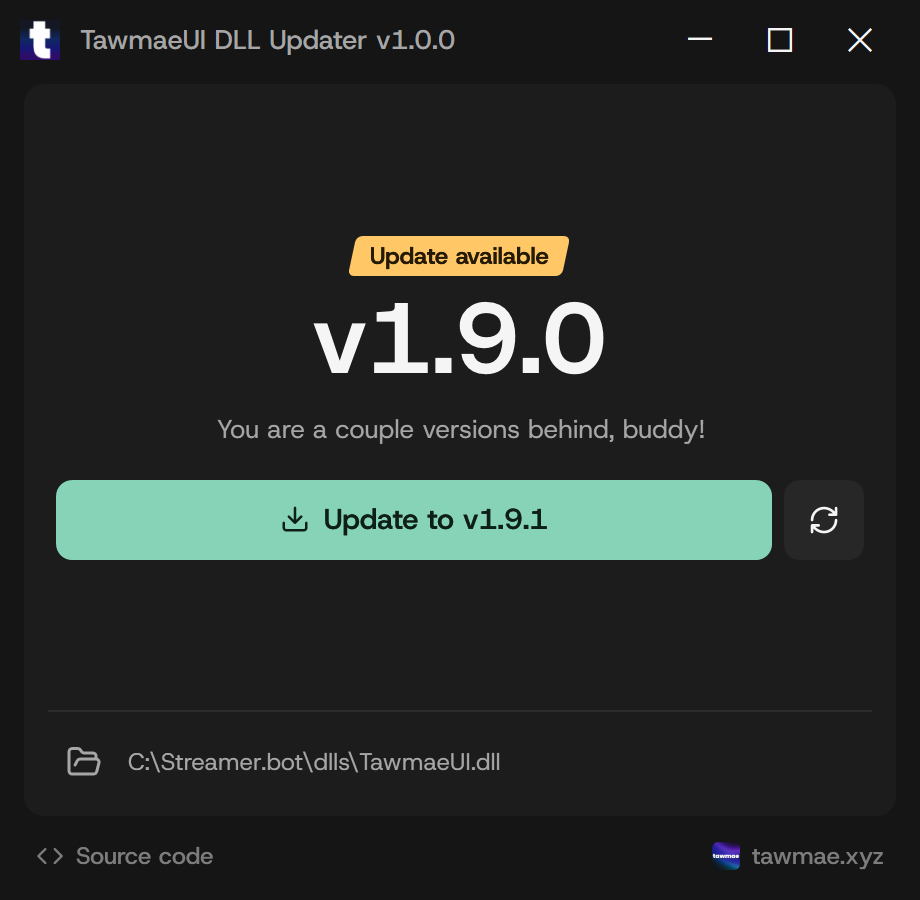

# TawmaeUI DLL Updater

Updates **TawmaeUI.dll** in your Streamer.bot to the latest version from [tawmae.xyz](https://www.tawmae.xyz).



## How to use

1. Download `TawmaeUI-DLL-Updater.zip` from the [latest release](https://github.com/tawmae/TawmaeUI-DLL-Updater/releases/latest).
2. Put `TawmaeUI DLL Updater.exe` from the zip into your Streamer.bot folder, next to `Streamer.bot.exe`.
3. Run it. If there is an update, close Streamer.bot and click **Update**.

The exe isn't code-signed, so Windows may show "Windows protected your PC" the first time.
Click **More info**, then **Run anyway**.

## What it does

- Reads the version of `dlls\TawmaeUI.dll` in the folder it runs from.
- Downloads `https://tawmae.xyz/downloads/TawmaeUI.dll` and reads its version. That download is
  the only connection it makes, and it sends nothing about you or your setup.
- Replaces the file only after you click **Update**, and only while the Streamer.bot in that folder
  is closed. It never closes Streamer.bot for you: ending it from outside can lose data. The
  **Update** button unlocks the moment Streamer.bot has exited, and the refresh button next to it
  checks everything again.
- Checks that the download really is a TawmaeUI.dll, writes it next to the old file and then swaps
  the two. If the swap fails, the old file stays in place.
- Keeps nothing else: no settings, logs, backups or registry entries.
- Runs without administrator rights. If Windows blocks changes to your Streamer.bot folder, it
  offers to restart as administrator.

## Check a download

Releases are built from this repository by GitHub Actions ([build.yml](.github/workflows/build.yml)),
and each release lists the SHA-256 of the zip and the exe. With the [GitHub CLI](https://cli.github.com)
you can check that a file was built here:

```
gh attestation verify "TawmaeUI DLL Updater.exe" --repo tawmae/TawmaeUI-DLL-Updater
```

## Build it yourself

You need Windows and the .NET SDK 8 or newer.

```
dotnet build -c Release
```

The exe is in `bin\Release\net48\`. It runs on .NET Framework 4.8, which comes with Windows 10
and 11.

## License

MIT, see [LICENSE](LICENSE). The Host Grotesk font is under the SIL Open Font License
([Assets/Fonts/OFL.txt](Assets/Fonts/OFL.txt)), the icons come from [Lucide](https://lucide.dev)
([THIRD-PARTY-NOTICES.md](THIRD-PARTY-NOTICES.md)). The tawmae name and logo are not covered by
the license.
